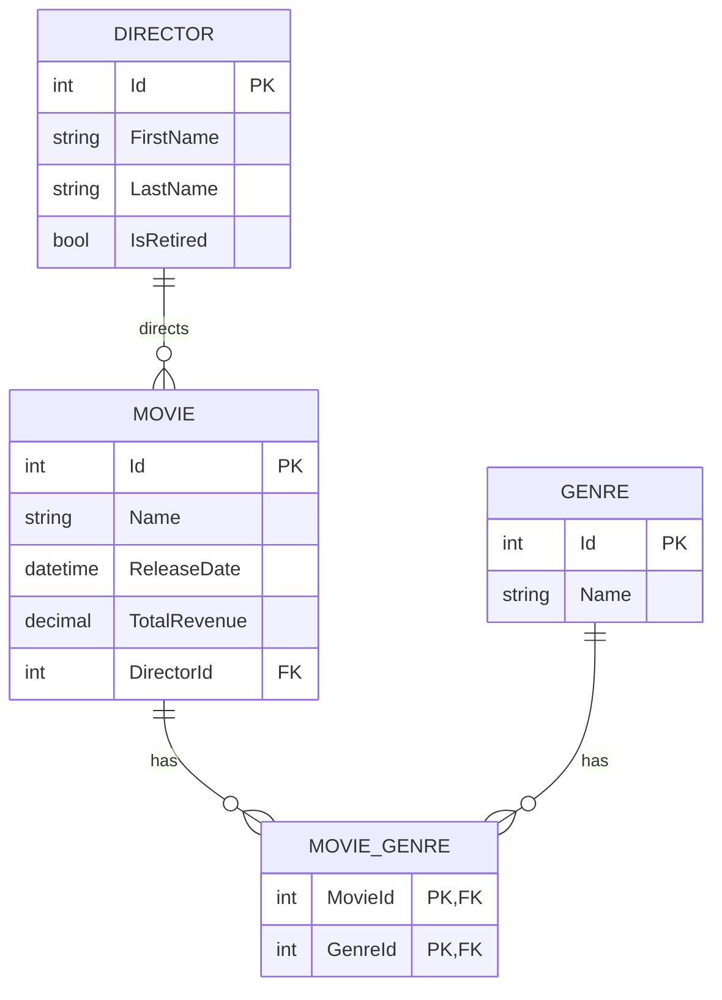

# Movie Catalog ER diagram

Phase 1 data model from the course MOVIES diagram. No additional entities or fields.

Rules:

- Director (1) to Movie (N) through `Movie.DirectorId`.
- Movie (N) to Genre (N) through `MovieGenre`.
- A director is deleted only when no movie references it; the API answers 409 Conflict otherwise.
- The database also restricts deleting a director with related movies.
- Deleting a movie or genre cascades to its MovieGenre links, not to the other principal entity.
- ReleaseDate is nullable. MovieId and GenreId together form the MovieGenre primary key; it has no database Id column.
